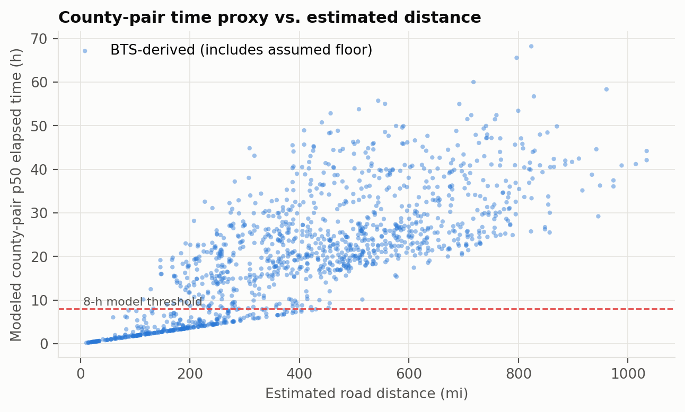
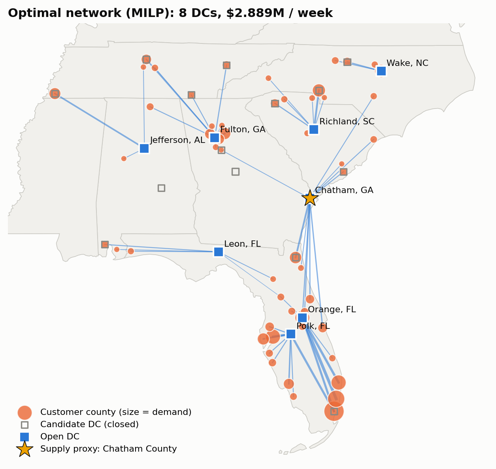
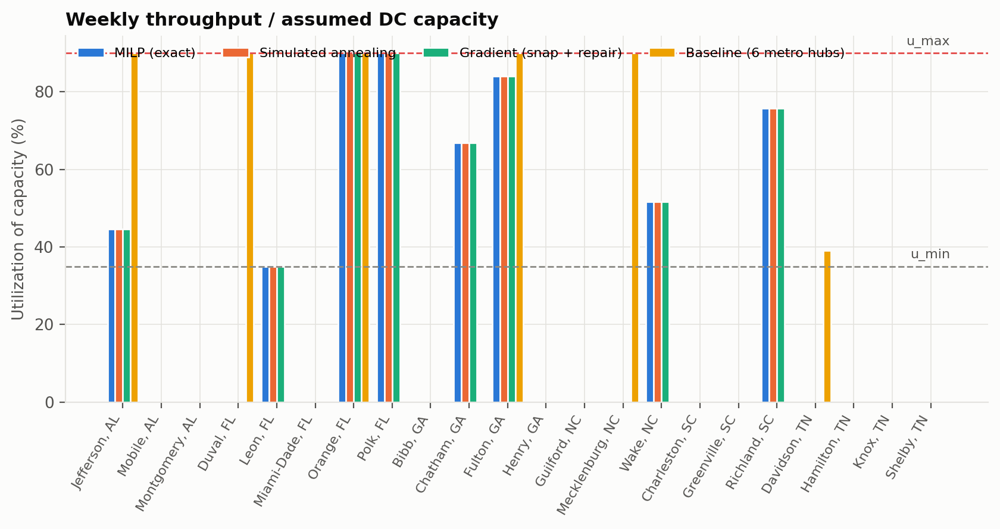
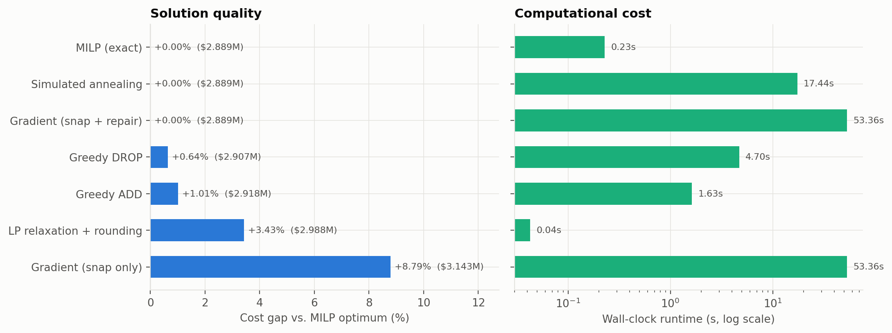
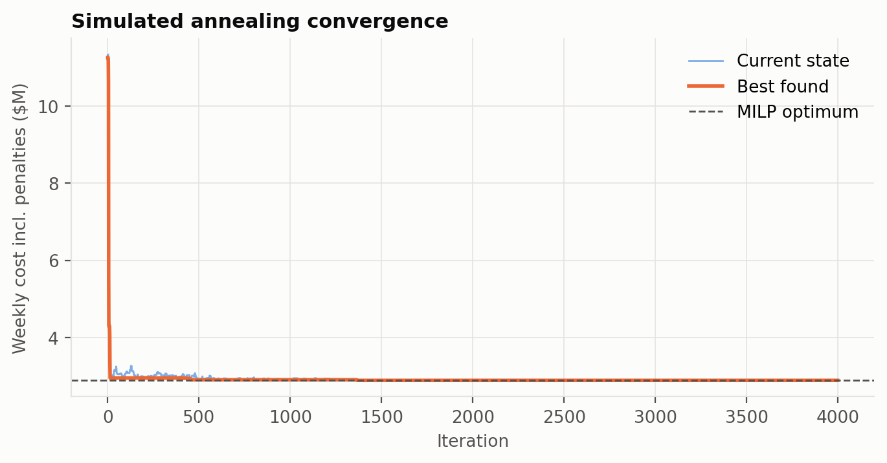
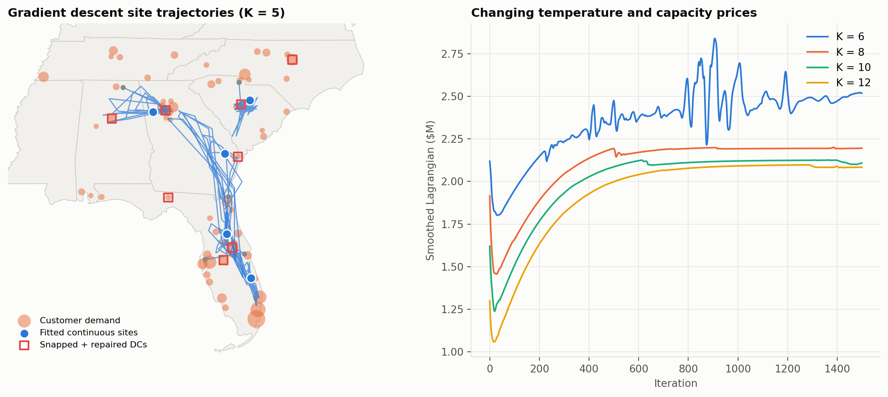
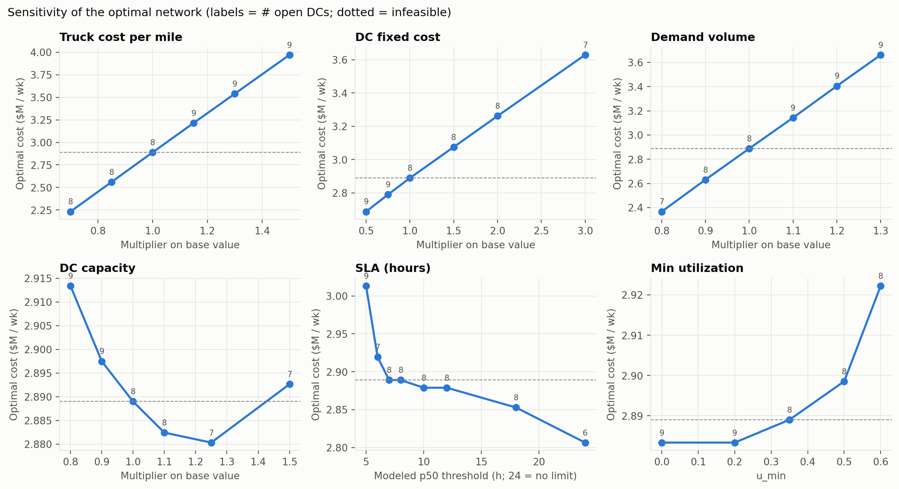
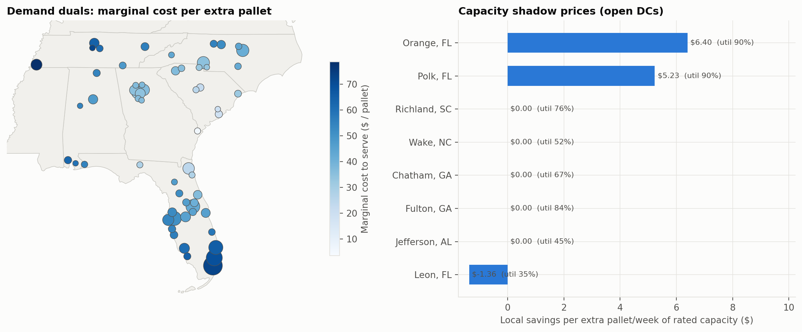
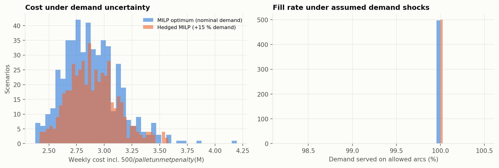

# Optimizing a Southeastern U.S. Distribution Network

Assignment 3: Optimization Techniques

Albert Kabore

## Abstract

This exercise selects distribution-center counties and weekly shipment volumes for a hypothetical network serving 60 counties in six southeastern states. Census population and warehousing statistics establish the regional pattern, and BTS county-pair truck times provide a travel-time proxy. A mixed-integer linear program (MILP), an LP relaxation, greedy search, simulated annealing, and a gradient-based location method are compared. The MILP selects 8 of 22 candidate counties at $2,889,006 per week, including $2,190,980 in transportation cost. This is 14.5% below the six-hub benchmark. All allocated volume uses arcs whose modeled median time is at most eight hours. The LP provides a lower bound, while heuristic and gradient results are assessed against the MILP and independent feasibility checks. Sensitivity analysis and 500 simulated demand scenarios examine cost, capacity, and service trade-offs.

## Introduction

Warehouse placement determines how shipments move from supply points to customers. Additional warehouses can shorten outbound trips, but they also add operating costs and may increase inbound travel. The planning problem is to choose locations and flows together while meeting demand, capacity, and service requirements.

The study covers Alabama, Florida, Georgia, North Carolina, South Carolina, and Tennessee. The 60 most populous counties form demand zones. A manually selected list of 22 counties defines the available facility choices. Chatham County, Georgia, represents a single supply point associated with Savannah.

The objectives are to formulate a facility-location problem, minimize transportation and facility operating costs, control utilization across centers, evaluate delivery-time restrictions, and compare linear, integer, heuristic, and gradient-based methods. The six assignment steps are implemented as data preparation, stated operational assumptions, model development, validation, model iteration, and reporting.

## Methodology

### Data collection and preprocessing

The source inputs are the 2019–2023 ACS total-population table B01003, 2022 County Business Patterns (CBP) for NAICS 493, 2020 county population mean centers, the 2023 county Gazetteer, and the experimental 2024 BTS county-pair truck-time dataset (U.S. Census Bureau, n.d., 2023b, 2024a, 2024b; Bureau of Transportation Statistics, 2026). Five-digit county FIPS codes join the files. The CBP extract keeps the all-size, all-legal-form rows. Missing source rows remain unknown; the selected candidate counties must have reported establishments and employment.

Source verification compared 534 Census population rows, 522 CBP rows across employment size classes, all 1,300 downloaded BTS rows, and the two geography files. All compared values matched the live source records. The verification results and file hashes are recorded in results/source_verification.json.

**Table 1. Data description**

| Source | Variables and units | Preprocessing / use |
|---|---|---|
| ACS B01003, 2019–2023 | Population; persons | Keep the largest 60 counties in six states; demand = population × 0.0015 pallets/week (assumed). |
| CBP 2022, NAICS 493 | Establishments; employees | County warehousing activity; 22 candidate counties chosen for this exercise. An assumed 3,000-employee threshold assigns capacity tiers. |
| 2020 population centers | Latitude/longitude; degrees | Population mean centers represent the county nodes. |
| 2023 Gazetteer | Land area; square miles | Density = population / land area; assumed facility-cost scaling uses density capped at 3,000 persons/sq mi. |
| BTS truck times, 2024 | County-pair p25/p50/p75; minutes | 1,300 source pairs; 180 adjusted with a centroid-distance floor; 20 local pairs assumed 30 minutes; 0 nonlocal imputations. |
| ATRI 2024 cost study | Truck operating cost; $/mile | Historical 2023 benchmark $2.270/mile; converted to pallet-mile costs using assumed loads and empty mileage. |

### Data cleaning and validation

Data preparation is executed before optimization and recorded in results/cleaning_audit.csv. County codes are trimmed and normalized to five digits, required numeric fields are parsed, and duplicate or missing keys are rejected. Population and business counts must be finite, nonnegative integers; flagged CBP totals require explicit treatment. Geographic joins are checked one-to-one, with valid coordinates and positive land area. Missing geography stops processing instead of silently removing counties.

**Table 2. Executed cleaning audit; full check descriptions are in cleaning_audit.csv**

| Stage | Input | Output | Affected | Operation type |
|---|---|---|---|---|
| Population | 534 | 534 | 0 | validation |
| CBP | 522 | 193 | 329 | selection |
| CBP | 193 | 193 | 0 | validation |
| County join | 534 | 534 | 341 | validation |
| Geography | 534 | 534 | 0 | validation |
| Customers | 534 | 60 | 474 | selection |
| Candidates | 534 | 22 | 512 | selection |
| BTS | 1300 | 1300 | 0 | validation |
| BTS | 1300 | 1300 | 0 | validation |
| Routes | 1300 | 1320 | 20 | join |
| Routes | 1320 | 1320 | 20 | modeling assumption |
| Routes | 1320 | 1320 | 0 | modeling assumption |
| Routes | 1320 | 1320 | 180 | modeling assumption |
| Processed data | 1320 | 1320 | 0 | validation |

Selecting CBP county totals retains 193 of 522 rows. The remaining rows contain employment-size breakdowns. 341 study counties have no CBP total in this extract; those values remain unknown. Every selected candidate has reported employment and establishments. No duplicates or long BTS elapsed times were removed. BTS year, nonnegative finite quartiles, and quartile order are checked. Local-time assignments and the distance-based floor are flagged in the processed route file, alongside the original source times.

The selected counties contain 36,122,211 residents in the source population estimates, producing 54,183.3 assumed pallets per week. Population supplies the demand weights, while CBP employment assigns the warehouse capacity tiers. The source years and the operational assumptions are listed in the data and input tables.

BTS measures stopped and moving elapsed time from the last truck observation in an origin county to the first in a destination county. Pairs with fewer than 100 observed movements are excluded, and movement counts are binned. The published quartiles summarize annual county-pair travel times (Bureau of Transportation Statistics, n.d.).

Estimated road distance is 1.20 times the great-circle distance between county centers. For this exercise, the p50 and p75 time proxies are floored at estimated miles / 55 mph × 60, with p75 constrained to be no less than p50. This adjustment aligns the time proxy with the estimated county-center distance. Raw times remain in the processed route file. All 20 missing pairs are same-county movements; each receives an assumed 30 minutes. The generic nonlocal imputation routine is unused in this instance.

*Figure 1. Modeled county-pair times and estimated distances; the horizontal line is the eight-hour exercise threshold.*

Travel times generally increase with estimated distance, but variation remains between county pairs. Only 24.8% of candidate routes satisfy the modeled 8 hour median threshold, restricting feasible assignments. The visible spread supports using route specific time estimates. This restriction makes geographic coverage important when selecting distribution centers and allocating demand.

### Operational assumptions and prior knowledge

**Table 3. Economic and operational inputs**

| Input | Value | Basis / use |
|---|---|---|
| Demand | 1.5 pallets per 1,000 residents per week | Assumed population-to-demand conversion |
| Facility tiers | Large: 12,000; small: 7,000 pallets/week | Assumed; county employment only assigns the tier |
| Facility fixed costs | $60,000 / $38,000 per week | Assumed; density factor ranges from 0.85 to 1.15 |
| Truck cost | $2.270 per vehicle-mile | ATRI historical 2023 operating-cost benchmark |
| Loads / empty mileage | 26 pallet positions; outbound 70% full; inbound 0.15 empty miles/loaded mile | Assumed average truck loading and mileage factors |
| Handling | $6 per pallet | Assumed constant per pallet handled |
| Utilization / time | 35%–90%; modeled p50 ≤ 480 minutes | Assumed throughput band and arc-screening rule |
| Inventory policy | One-week ordering cycle; 0.5-week lead time; z = 1.645; $4/pallet-week | Approximate inventory indicators; holding cost excluded from network objective |
| Demand uncertainty | County shock CV 25%; shared regional shock CV 8% | Assumed mean-one lognormal shocks; shortages priced at $500/pallet |

The truck-cost benchmark is the 2023 average in ATRI's 2024 update (Leslie & Murray, 2024; American Transportation Research Institute, 2024). Outbound cost is 2.270 / (26 × 0.70) = $0.1247 per pallet-mile. Inbound cost is 2.270 × 1.15 / 26 = $0.1004 per pallet-mile. The 15% allowance means empty miles per loaded mile. Costs use estimated distance, while the time restriction uses the county-pair time proxy.

### Mathematical formulation

Let i index candidate counties and j index demand counties. Binary yᵢ opens a distribution center. Continuous xᵢⱼ is the fraction of county j's demand assigned to i. Demand dⱼ is measured in pallets/week, Kᵢ is rated weekly throughput capacity, fᵢ is weekly fixed cost, and cᵢⱼ is inbound plus handling plus outbound dollars/pallet.

minimize  Σᵢ fᵢyᵢ + ΣᵢΣⱼ cᵢⱼdⱼxᵢⱼ

Σᵢ xᵢⱼ = 1  for each j

0.35 Kᵢyᵢ ≤ Σⱼ dⱼxᵢⱼ ≤ 0.90 Kᵢyᵢ  for each i

xᵢⱼ ≤ yᵢ;  0 ≤ xᵢⱼ ≤ 1;  yᵢ ∈ {0,1}

xᵢⱼ = 0 whenever modeled tᵢⱼ⁵⁰ > 480 minutes

The model has 22 binary location variables and 1,320 continuous assignment variables. It permits split sourcing and fractional pallets in weekly aggregate flows. Supply is assumed sufficient; inbound volume equals each center's outbound throughput. The objective includes fixed facilities, inbound transport, handling, and outbound transport. Inventory holding is calculated separately from the weekly network objective.

The throughput band prevents opening a center with arbitrarily little assigned volume. Under the common one-week ordering-cycle policy, average cycle stock is Iᵢ = 0.5 Σⱼdⱼxᵢⱼ. Thus the throughput band also bounds normalized cycle stock: 0.175 Kᵢyᵢ ≤ Iᵢ ≤ 0.45 Kᵢyᵢ. Inventory levels are calculated after routing. Safety stock uses z√(lead time × weekly variance), with both county-specific and shared regional variation included. The normal approximation uses z = 1.645 and the nominal routing allocations. The separate demand simulation evaluates capacity and shipment allocation for each demand realization.

### Algorithms and comparison design

The reference MILP is solved with HiGHS through SciPy, with a relative optimality-gap tolerance of 10⁻⁶. Replacing binary y with 0 ≤ y ≤ 1 gives the LP lower bound. The LP-based rounding heuristic opens every location with y > 10⁻⁶, then solves the fixed-network transportation LP (SciPy, n.d.-a, n.d.-b). Every resulting network is audited for demand, throughput, capacity, and time constraints.

Greedy ADD starts with no open centers and accepts the best cost-reducing opening. Greedy DROP starts with all centers open and accepts the best closing. Simulated annealing uses 4,000 flip/swap proposals, seed 42, and a geometric temperature schedule from 0.02 to 0.00001. An uphill move is accepted with exp[−Δ / (temperature × current cost)] (Kirkpatrick et al., 1983). Each network is scored by an LP in pallet-flow units. Search scores permit unmet demand and minimum-throughput shortfall at $500/pallet. Costs are compared with the MILP only after an independent audit confirms feasibility.

The gradient method fits K continuous sites in an approximate planar coordinate system. Its smooth transport surrogate includes inbound/outbound distance, a soft distance penalty for the time proxy, and capacity prices. Let gⱼₖ be these per-pallet terms including capacity price μₖ, and C be the common surrogate capacity. The Lagrangian is:

L(z, μ) = Σⱼ dⱼ [−τ log Σₖ exp(−gⱼₖ/τ)] − C Σₖ μₖ

Site positions use Adam updates (Kingma & Ba, 2015); nonnegative capacity prices use projected dual ascent. K ranges from 5 to 12 with 4 restarts and 1,500 iterations per restart. Temperature falls from 20 to 0.2. The distance penalty begins around 200 estimated road miles, based on a coarse empirical time-screening rule. A linear assignment maps the fitted points to distinct candidate counties. A local repair step opens or closes sites to reduce unmet demand and throughput deficits. Feasible candidates are ranked by exact network cost. The continuous stage approximates geography, capacities, and travel times; the discrete evaluation adds site-specific fixed costs and enforces the network constraints.

The methods address different parts of the problem. The MILP supplies a certified reference for this finite candidate list; the LP quantifies a lower bound; the heuristics demonstrate discrete search; and the gradient method tests a smooth location approximation followed by discrete evaluation. They are compared on feasibility, cost, selected centers, and elapsed computation time.

### Validation, iteration, and sensitivity design

Independent checks cover demand equality, maximum capacity, minimum throughput, the time-proxy screen, shipments from open centers only, and nonnegative flows. For a 12-candidate reduced instance, every nonempty open set is evaluated with hard demand and throughput constraints and compared with the MILP. Automated tests also compare demand/capacity marginal values with numerical cost changes and analytic gradients with finite differences.

The iteration study adds capacity, the time screen, minimum throughput, and then single sourcing. Six one-at-a-time parameter sweeps are supplemented by ±20% shocks to seven cost and operating inputs. Shadow prices come from a fixed-network LP; they describe local changes while the open-center set is held constant.

The simulation uses 500 paired scenarios, seed 7. Each county's demand is multiplied by independent mean-one lognormal shocks for that county and the whole region. The combined county CV is about 26.3%. For each scenario, the same fixed-network LP reallocates flows and prices shortages. The two designs are the nominal MILP and a MILP designed for 15% higher demand.

## Results

### Selected network and cost

The MILP selects 8 centers: **Jefferson, AL; Leon, FL; Orange, FL; Polk, FL; Chatham, GA; Fulton, GA; Wake, NC; Richland, SC**. The solver reports a relative gap of 0; solve time is 0.228 seconds on this run. Weekly network cost is $2,889,006, or $53.32 per pallet.

**Table 4. Optimal weekly cost**

| Cost component | $/week |
|---|---|
| Facility fixed | $372,926 |
| Inbound transportation | $1,365,255 |
| Outbound transportation | $825,725 |
| Handling | $325,100 |
| Total network | $2,889,006 |

Transportation alone costs $2,190,980 per week. Average modeled outbound distance is 122.2 estimated road miles. The flow-weighted average of arc p50 time proxies is 2.54 hours. All assigned volume uses arcs passing the p50 screen, while 70.4% uses arcs whose p75 proxy also passes eight hours.

Map backgrounds use Census 2023 state cartographic boundaries for geographic orientation (U.S. Census Bureau, 2023a). Lines connect the selected center and demand nodes, with line widths representing assigned weekly volumes.

*Figure 2. Selected county centers and weekly flows. Lines show shipment assignments; the star marks the Chatham County supply proxy.*

The selected network uses 8 centers serving modeled demand at $2,889,006 weekly. Allocation balances inbound transportation, outbound distance, fixed costs, and travel times. Its 14.5% cost advantage over the six-hub benchmark accompanies compliance with the median time screen. The counties provide a shortlist for evaluating properties, transport access, and coverage.

**Table 5. Throughput and inventory-policy indicators; stock units are pallets**

| Center | Pallets/week | Utilization | Cycle stock | Safety stock (approx.) |
|---|---|---|---|---|
| Jefferson, AL | 3,121 | 44.6% | 1,560 | 597 |
| Leon, FL | 2,450 | 35.0% | 1,225 | 386 |
| Orange, FL | 10,800 | 90.0% | 5,400 | 1,670 |
| Polk, FL | 10,800 | 90.0% | 5,400 | 1,537 |
| Chatham, GA | 8,025 | 66.9% | 4,013 | 1,055 |
| Fulton, GA | 10,075 | 84.0% | 5,038 | 1,330 |
| Wake, NC | 3,615 | 51.6% | 1,808 | 688 |
| Richland, SC | 5,296 | 75.7% | 2,648 | 811 |

Cycle stock totals 27,092 pallets and approximate safety stock 8,071 pallets. At the assumed holding rate, their reported weekly holding cost is $140,652; it is excluded from the network objective. Inventory quantities scale with throughput under the common coverage policy.

*Figure 3. Throughput utilization relative to the assumed 35%–90% band.*

Utilization ranges from 35% to 90% across the selected centers, indicating uneven workloads within the permitted band. Orange and Polk reach the upper limit, while Leon operates at the minimum. Additional capacity has different value across sites. Capacity planning should prioritize constrained centers while accounting for each location's minimum throughput.

### LP, heuristic, and gradient comparisons

The continuous LP relaxation is a lower bound of $2,884,609 per week. The difference (MILP − LP) / LP is 0.152%. There are 5 fractional facility variables.

**Table 6. Method comparison. *Feasibility and gaps use all base-model constraints.**

| Method | Centers | Cost incl. search penalties | Gap* | Feasible* | Time (s) |
|---|---|---|---|---|---|
| MILP (exact) | 8 | $2,889,006 | -0.00% | Yes | 0.228 |
| LP relaxation + rounding | 11 | $2,988,062 | +3.43% | Yes | 0.043 |
| Greedy ADD | 7 | $2,918,129 | +1.01% | Yes | 1.627 |
| Greedy DROP | 10 | $2,907,404 | +0.64% | Yes | 4.703 |
| Simulated annealing | 8 | $2,889,006 | +0.00% | Yes | 17.441 |
| Gradient (snap only) | 10 | $3,143,046 | +8.79% | Yes | 53.363 |
| Gradient (snap + repair) | 8 | $2,889,006 | +0.00% | Yes | 53.363 |
| Baseline (6 metro hubs) | 6 | $3,378,578 | — | No | 0.016 |

The six-hub benchmark uses Jefferson, Duval, Orange, Fulton, Mecklenburg, and Davidson counties and is routed without the time screen. Feasible-solution rankings include only methods that pass all base-model constraints. The cost column includes any search penalties. Runtimes are elapsed seconds for the recorded run on the platform listed in the appendix. The two gradient rows share the same multi-restart search time.

*Figure 4. Cost gaps and runtimes for solutions that pass every base-model constraint.*

Exact optimization provides the lowest feasible cost for this candidate set. Simulated annealing and repaired gradient search match that reference, while greedy methods remain close. LP rounding opens additional centers and increases cost. The MILP combines the best cost with a short solve time, making it the strongest reference method.

*Figure 5. Simulated-annealing search scores and the MILP reference; scores include any unmet-demand or throughput penalties.*

The best simulated annealing score approaches the MILP reference as location changes improve the network. Temporary increases in current cost reflect accepted exploratory moves. The final feasible network matches the reference cost. The trajectory illustrates how accepting temporary deterioration helps search different location combinations before retaining the best feasible allocation.

*Figure 6. Gradient trajectories and the smoothed Lagrangian as capacity prices and temperature change.*

Continuous site trajectories show how gradient updates explore potential locations before snapping to candidate counties. The changing Lagrangian reflects temperature and capacity price updates during search. Discrete repair closes the cost gap after snapping. This result supports combining geographic exploration with feasible network evaluation and local adjustments to warehouse selections.

### Validation and model iteration

The independent audit passes for 7 of 7 optimized solutions. The reduced enumeration examines 4,095 nonempty subsets, of which 90 are feasible. Its best cost is $2,851,567.72, compared with $2,851,567.72 from the reduced MILP; the relative difference is 4.9e-16. Exhaustive enumeration checks the reduced solution, while the full-instance MILP reports its termination status and optimality gap.

**Table 7. Independent constraint checks**

| method | demand met | capacity | balance | sla | only open dcs ship | non negative |
|---|---|---|---|---|---|---|
| MILP (exact) | Pass | Pass | Pass | Pass | Pass | Pass |
| LP relaxation + rounding | Pass | Pass | Pass | Pass | Pass | Pass |
| Greedy ADD | Pass | Pass | Pass | Pass | Pass | Pass |
| Greedy DROP | Pass | Pass | Pass | Pass | Pass | Pass |
| Simulated annealing | Pass | Pass | Pass | Pass | Pass | Pass |
| Gradient (snap only) | Pass | Pass | Pass | Pass | Pass | Pass |
| Gradient (snap + repair) | Pass | Pass | Pass | Pass | Pass | Pass |

**Table 8. Constraint additions and single-sourcing variant**

| Version | Centers | $/week | p50 proxy ≤ 8 h | Utilization CV |
|---|---|---|---|---|
| v1 Uncapacitated | 3 | $2,713,045 | 73.5% | 0.241 |
| v2 + Capacity | 6 | $2,806,453 | 71.6% | 0.140 |
| v3 + Delivery-time SLA | 9 | $2,883,343 | 100.0% | 0.353 |
| v4 + Minimum throughput (base) | 8 | $2,889,006 | 100.0% | 0.297 |
| v5 + Single sourcing | 9 | $2,895,986 | 100.0% | 0.320 |

The first four versions successively add restrictions to the same split-sourcing problem. The fifth requires each county to use a single center. A constraint can increase minimum cost while changing the selected site count in either direction. The cost differences quantify the effect of each added restriction.

### Sensitivity and simulated demand

**Table 9. Reoptimized one-at-a-time changes**

| Input | Cost change at −20% | Cost change at +20% |
|---|---|---|
| DC capacity | +0.84% | -0.19% |
| Handling cost | -2.25% | +2.25% |
| DC fixed cost | -2.73% | +2.58% |
| Outbound load factor | +5.10% | -5.33% |
| Circuity factor | -15.17% | +15.04% |
| Truck cost per mile | -15.17% | +15.04% |
| Demand volume | -18.05% | +17.89% |

*Figure 7. Reoptimized cost across parameter sweeps. Labels give open-center counts; infeasible settings are marked.*

Increasing truck costs by 15% changes the selected network from 8 to 9 centers. Cost and location choices respond differently across the parameter sweeps. Capacity changes also alter minimum throughput requirements, explaining why expansion need not reduce cost. Planners should consider transportation economics and throughput policies when evaluating network changes.

**Table 10. Local LP capacity savings for a fixed open-center set**

| Center | Upper-bound relaxation ($/pallet) | Rated-capacity change ($/pallet/week) |
|---|---|---|
| Jefferson, AL | 0.00 | 0.00 |
| Leon, FL | 0.00 | -1.36 |
| Orange, FL | 7.11 | 6.40 |
| Polk, FL | 5.81 | 5.23 |
| Chatham, GA | 0.00 | 0.00 |
| Fulton, GA | 0.00 | 0.00 |
| Wake, NC | 0.00 | 0.00 |
| Richland, SC | 0.00 | 0.00 |

The first marginal-value column relaxes the usable upper throughput bound alone. The second increases rated K by one pallet/week, changing the upper bound by 0.90 and the lower bound by 0.35. These values can differ and can change when an active constraint changes. Demand marginal values are obtained with demand on the right-hand side of a pallet-flow LP; small finite-difference checks verify their units.

*Figure 8. Fixed-network demand marginal costs and local rated-capacity savings.*

Orange and Polk offer rated capacity savings of $6.40 and $5.23 per additional weekly pallet, respectively. Leon has a negative capacity value because expansion also raises minimum throughput. Demand marginal costs vary geographically. These fixed-network marginal values identify where small capacity adjustments offer savings and prioritize expansion options for analysis.

**Table 11. Demand simulation: 500 paired scenarios**

| Design | Centers | Mean penalized cost | 95th pct. cost | Mean fill | P(unmet > 1 pallet) |
|---|---|---|---|---|---|
| MILP optimum (nominal demand) | 8 | $2,884,375 | $3,323,672 | 99.995% | 0.6% |
| Hedged MILP (+15 % demand) | 9 | $2,896,231 | $3,292,234 | 100.000% | 0.0% |

*Figure 9. Simulated costs and quantities filled on arcs that pass the time-proxy screen.*

Across 500 simulated demand scenarios, the nominal design fills 99.995% of demand on average. The design for higher demand records no sampled shortages, with mean penalized cost increasing by 0.41%. This comparison supports evaluating capacity flexibility. Planning should weigh the facility commitments against lower shortage exposure under the tested conditions.

## Analysis and Discussion

The six-hub benchmark costs $3,378,578 per week, against $2,889,006 for the selected design, a difference of $489,573 (14.5%). The comparison network places 82.6% of its flow on arcs passing the p50 screen, compared with 100% for the selected design. Jointly choosing warehouse locations and shipment assignments reduces weekly cost while meeting the median-time constraint.

Inbound transport accounts for 47.3% of selected network cost. The supply node is co-located with the Chatham candidate, giving that center zero modeled inbound mileage. This treatment highlights the influence of the supply-point location on facility selection. A property-level evaluation can add port drayage distance and location-specific handling costs.

Simulated annealing finishes +0.00% from the reference cost in this seeded run; the repaired gradient method finishes +0.00% from it. The MILP supplies the optimality certificate and has the shortest runtime among these three methods. The gradient approach combines a smooth geographic surrogate with discrete repair, which improves the snapped network to the reference cost. This improvement shows why feasibility repair is valuable after continuous fitting.

The largest changes in reoptimized cost under the tested ±20% shocks come from demand volume, circuity factor, truck cost per mile. Each sweep changes one parameter at a time. Changing capacity also changes the minimum-throughput requirement, so more rated capacity need not lower cost under that policy. Circuity changes cost distances while the main time-proxy matrix is held fixed. The resulting cost changes measure the effect of distance assumptions on network design.

Under the assumed demand distribution, nominal mean fill is 99.995%, and 0.6% of scenarios have more than one unmet pallet. The design for 15% higher demand has 9 centers and mean fill 100.000%, with +0.41% mean penalized cost relative to the nominal design. Flow reallocation adapts shipments to each scenario. The higher-demand design exchanges a small increase in mean cost for improved fill rates across the tested scenarios.

The formulation operates at county level with weekly aggregate flows. Property-level sites, delivery schedules, driver hours, loading queues, and multi-period inventory balances are useful extensions for operational planning. Correlated transport disruptions can also be added to the demand uncertainty analysis.

## Recommendations

1. Use the selected counties as a shortlist for further investigation. Obtain actual facility addresses, availability, lease and labor costs, dock capacity, storage capacity, and port access to compare properties within each county.

2. Replace the population-based pallet rate with historical customer orders and observed shipment sizes. Fit demand forecasts on past periods and evaluate them on later periods before passing forecasts and uncertainty ranges into the optimizer.

3. Estimate route-specific delivery distributions from dispatch and arrival records. Choose the service percentile and promised delivery window explicitly, including loading, unloading, and driver constraints. Use BTS county summaries as regional benchmarks alongside trip-level records.

4. Evaluate extra capacity where fixed-network marginal savings are positive, then reoptimize with realistic expansion increments and costs. Use the demand-growth design to assess the costs and benefits of preparing for demand growth.

5. Add a multi-period inventory model if stock balancing is a business requirement. Include opening inventory, replenishment, customer shipments, storage limits, holding cost, and shortages. The present throughput band only controls normalized cycle stock under the stated coverage policy.

6. Connect validated demand and travel predictions to the MILP, monitor forecast error and constraint violations, and rerun the analysis as orders and operating conditions change. Test the resulting plans on historical periods and compare their costs and service outcomes with the current planning process.

## Conclusion

For the defined historical-data scenario, the MILP selects 8 county centers at $2,889,006 per week and satisfies the demand, capacity, throughput, and modeled median-time constraints. The LP supplies a lower bound; simulated annealing and the repaired gradient method match the MILP cost and pass the feasibility audit. Sensitivity analysis identifies demand, transport cost, and distance as major cost drivers. The demand-growth design improves sampled fill rates with a small increase in mean penalized cost. Together, these results support evaluating warehouse placement, capacity flexibility, and service requirements as connected planning decisions.

## References

American Transportation Research Institute. (2024, June 25). *New ATRI research: Industry costs increased more than 6 percent during freight recession.* https://truckingresearch.org/2024/06/new-atri-research-industry-costs-increased-more-than-6-percent-during-freight-recession/

Bureau of Transportation Statistics. (n.d.). *Trucking movements: BTS Freight Mobility Initiative (FMI).* U.S. Department of Transportation. https://www.bts.gov/explore-topics-and-geography/topics/freight-transportation/trucking-movements-bts-freight-mobility

Bureau of Transportation Statistics. (2026). *BTS ATRI Freight Mobility Initiative: County-to-county truck travel times (2024)—Experimental* [Data set]. U.S. Department of Transportation. https://data.bts.gov/d/uta5-4eu5

Kingma, D. P., & Ba, J. (2015). Adam: A method for stochastic optimization. *3rd International Conference on Learning Representations.* https://arxiv.org/abs/1412.6980

Kirkpatrick, S., Gelatt, C. D., Jr., & Vecchi, M. P. (1983). Optimization by simulated annealing. *Science, 220*(4598), 671–680. https://doi.org/10.1126/science.220.4598.671

Leslie, A., & Murray, D. (2024). *An analysis of the operational costs of trucking: 2024 update.* American Transportation Research Institute. https://truckingresearch.org/2024/06/an-analysis-of-the-operational-costs-of-trucking-2024-update/

SciPy. (n.d.-a). *linprog.* https://docs.scipy.org/doc/scipy-1.16.3/reference/generated/scipy.optimize.linprog.html

SciPy. (n.d.-b). *milp.* https://docs.scipy.org/doc/scipy-1.16.3/reference/generated/scipy.optimize.milp.html

U.S. Census Bureau. (n.d.). *Centers of population for the 2020 Census* [Data set]. https://www.census.gov/geographies/reference-files/2020/geo/2020-centers-population.html

U.S. Census Bureau. (2023a). *Cartographic boundary files: States, 1:20,000,000* [Data set]. https://www2.census.gov/geo/tiger/GENZ2023/kml/cb_2023_us_state_20m.zip

U.S. Census Bureau. (2023b). *Gazetteer files: 2023 counties* [Data set]. https://www.census.gov/geographies/reference-files/time-series/geo/gazetteer-files.2023.html

U.S. Census Bureau. (2024a). *All sectors: County Business Patterns, including ZIP Code Business Patterns, by legal form of organization and employment size class for the U.S., states, and selected geographies: 2022* (Table CB2200CBP) [Data set]. https://data.census.gov/table/CBP2022.CB2200CBP

U.S. Census Bureau. (2024b). *Total population: 2019–2023 American Community Survey 5-year estimates* (Table B01003) [Data set]. https://data.census.gov/table/ACSDT5Y2023.B01003

## Appendix: Reproducibility

Run python -m pytest -q for automated validation, python run_pipeline.py for the complete analysis from cached source files, and python report/build_docx.py for matching Word and Markdown reports. python verify_sources.py checks source values over the network and records hashes. --refresh-data downloads source files again; --quick uses fewer restarts and simulation scenarios and is not used for these results.

This run used Python 3.11.0, NumPy 2.3.4, and pandas 2.3.3. Platform: Windows-10-10.0.26300-SP0. The full analysis took 173.1 seconds. Seeds, algorithm settings, parameters, and source-verification state are stored in results/summary.json. Detailed decisions are in optimal_flows.csv, inventory_policy.csv, candidates.csv, and customers_demand.csv. The accompanying notebook runs the analysis and displays the same saved tables and figures.
